# Diário de pesquisa

## Contexto do TCC

O TCC treina o monstro de um jogo de terror com aprendizado por reforço (Unity ML-Agents, PPO): o agente aprende a
explorar o mapa e caçar o jogador por tentativa e erro, ao longo de milhões de steps. Cada versão do cérebro costuma
**herdar os pesos de um run anterior** (`mlagents-learn --initialize-from=<run>`) em vez de começar do zero, então o
cérebro que está hoje no jogo é o fim de uma cadeia de mais de dez runs.

## Pergunta de pesquisa

Como o `expo-sqlite` guarda no celular a árvore de herança dos cérebros treinados (quem herdou de quem com
`--initialize-from`) e responde "de onde veio este cérebro e quanto treino ele acumulou?", na condição de os logs de
treino (`results/`) só existirem no PC de treino, fora do git, e de a consulta precisar funcionar sem internet, na
frente da banca?

## Alternativas consideradas

| Opção | Serve para | Decisão |
|---|---|---|
| `expo-sqlite` | Banco relacional local, com SQL, transações e restrições | **Sim.** A herança é uma tabela que aponta para ela mesma (`pai → run_id`); uma consulta `WITH RECURSIVE` sobe a árvore inteira, e o próprio banco recusa run repetido e pai inexistente. Funciona no Expo Go. |
| `@react-native-async-storage/async-storage` | Chave-valor assíncrono, sem criptografia | Não. Guardaria a lista inteira como um JSON; subir a árvore, somar steps e checar pai inexistente viraria código JavaScript meu, sem garantia do banco. |
| `expo-secure-store` | Guardar segredos pequenos (tokens, senhas), criptografados | Não. É para segredos, não para uma tabela de dados. |
| `expo-file-system` (arquivo JSON) | Ler e gravar arquivos | Não. Mesmo problema do AsyncStorage: sem consulta nem restrição, e a gravação concorrente fica por minha conta. |
| JSON fixo dentro do app | Mostrar dados que não mudam | Não. Resolve a leitura, mas um run novo (o próximo treino) não teria onde ser gravado. |
| App buscar os logs no PC pela rede | Acompanhar o treino ao vivo | Não. Quebra a condição da pergunta (na banca não há o PC nem rede garantida) e é monitoramento, outro tema. O PC só **exporta** um arquivo; quem guarda e consulta é o SQLite do celular. |
| `react-native-mmkv` (sugerido pelo DeepSeek) | Chave-valor rápido | Não. Mesmo limite do AsyncStorage (sem consulta nem relação), e a instalação no Expo pede `npx expo prebuild`, ou seja, código nativo fora do Expo Go. |

## Mapa do tema em duas IAs (exercício 3)

Em 07/11/2026, o mesmo prompt da seção 4.2 da apostila foi enviado ao **Gemini** e ao **DeepSeek**:

> Estou fazendo meu TCC: um jogo de terror em Unity em que o monstro é treinado com aprendizado por reforço (Unity
> ML-Agents), e cada treino herda o cérebro do treino anterior. Preciso resolver o seguinte problema: guardar no
> celular a árvore de herança dos treinos (quem herdou de quem e quantos steps cada um treinou) e consultá-la sem
> internet, porque os logs só existem no PC de treino. O app é feito com React Native e Expo, em TypeScript. Quais são
> as alternativas para resolver isso nesse ecossistema? Para cada uma, diga em uma frase quando ela é a melhor escolha
> e quando não é, e indique a página da documentação oficial que eu devo ler. Não escreva código ainda.

**Onde concordaram:** as duas puseram `expo-sqlite`, `expo-file-system` (arquivo JSON) e AsyncStorage, e as duas
recomendam o SQLite quando é preciso consultar ancestrais e descendentes.

**Onde divergiram, e o que a fonte confirma:**

| Ponto | Gemini | DeepSeek | O que a fonte diz |
|---|---|---|---|
| Quantas alternativas | 3 | 6 (+ MMKV, `react-native-cozo`, Dync) | A página *Store data* do Expo cita só quatro: SecureStore, FileSystem, SQLite e Async Storage. MMKV, Cozo e Dync não aparecem. |
| Link do AsyncStorage | `react-native-async-storage.github.io/async-storage/` | `react-native-async-storage.github.io/` | O do Gemini dá **404**. O do DeepSeek redireciona para `/latest/`, a documentação oficial. O Expo também tem a página própria (SDK 58). |
| Consulta da árvore | "consultas relacionais complexas" | cita CTE recursiva com `parent_id` | A página do `expo-sqlite` não fala de consulta recursiva; quem documenta é o próprio SQLite (`lang_with.html`). O DeepSeek acertou o mecanismo. |
| MMKV no Expo Go | — | não diz que precisa de build nativo | O README manda rodar `npx expo prebuild` (gera código nativo), então não roda no Expo Go. A resposta omitiu isso. |
| `react-native-cozo` | — | "não funciona no Expo Go", link como "documentação oficial" | O README confirma: "won't work with Expo Go. You must use a development build". Mas é um plugin de terceiro com 5 estrelas, não a documentação oficial do Cozo, cujo README não tem React Native. |
| JSON via FileSystem | "a árvore gerada no PC, exportada como JSON, só para leitura" | "snapshot, sem consultas" | É quase o caminho do `tools/exportar_linhagem.py`. A diferença é que aqui o JSON só **alimenta** o SQLite, porque o celular também registra runs, o caso em que a própria resposta do Gemini diz que o arquivo não serve. |
| Versão da documentação | links `latest` | links `latest` | Hoje `latest` = SDK 58, mas o `AGENTS.md` pede a versão exata do SDK (`v58.0.0`): quando sair o SDK 59, esses links passam a descrever outra versão. |

**Conclusão:** a escolha do `expo-sqlite` se mantém. A resposta mais longa (DeepSeek) trouxe mais opções, mas parte
delas é de nicho ou fora do Expo Go, e chamou de "oficial" um repositório pequeno de terceiro. A mais curta (Gemini)
errou um link. Nas duas, só a documentação desempatou.

## Como funciona

```mermaid
flowchart LR
  subgraph PC["PC de treino"]
    R["results/ (logs do TensorBoard + .onnx)"] --> S["tools/exportar_linhagem.py"]
    S --> J["db/runsDoPc.json"]
  end
  J -. "vai junto no app" .-> A
  A[App abre] --> B["onInit: PRAGMA foreign_keys = ON"]
  B --> C{"PRAGMA user_version"}
  C -- "0 (primeira vez)" --> D["CREATE TABLE runs + 23 runs do TCC"]
  C -- "1 (app antigo)" --> M["ALTER TABLE: colunas do cérebro"]
  D --> M
  M --> I["INSERT ... ON CONFLICT: junta os runs do PC"]
  C -- "2" --> I
  I --> E[Lista de runs]
  E -- toca num run --> F["WITH RECURSIVE: sobe pelos pais até o run do zero"]
  F --> G["Linhagem + cérebro: gerações, steps, entradas, saídas, rede"]
  E -- "+ Run" --> H["INSERT: o banco recusa run-id repetido (PRIMARY KEY) e pai inexistente (REFERENCES)"]
```

- **Tabela `runs`**: `run_id` é a chave; `pai` referencia outro `run_id` da mesma tabela (nulo = treinado do zero);
  `CHECK (pai <> run_id)` impede um run de herdar de si mesmo. Como um run só pode apontar para um pai que **já existe**
  e o pai não é editado depois, não dá para formar ciclo.
- **Migração por `PRAGMA user_version`**: o número fica gravado no próprio arquivo do banco. Na primeira abertura é 0:
  cria a tabela e insere os runs do TCC. A versão 2 acrescenta as colunas do cérebro com `ALTER TABLE`, então um
  celular que já tinha a versão 1 ganha as colunas sem perder o que foi registrado à mão.
- **Importação do PC**: o script lê a `results/` e grava `db/runsDoPc.json`, que vai junto no app. A cada abertura
  o app faz `INSERT ... ON CONFLICT (run_id) DO UPDATE`: run novo entra, run existente recebe o que é medido nos
  logs (pai, steps, entradas, saídas, rede, métricas), e o texto escrito à mão (versão, resultado, modelo) fica.
  Nada é apagado, por isso um run registrado no formulário sobrevive à importação.
- **De onde sai a herança**: não do `configuration.yaml`. Quando um treino é retomado com `--resume`, o ML-Agents
  regrava esse arquivo com `initialize_from: null` (aconteceu em 6 runs, como `v7.4.4_planta_01`). O script lê o
  primeiro log do TensorBoard de cada run, onde o ML-Agents grava as configurações do início com o `init_path`
  do run pai.
- **Dados do cérebro**: entradas e saídas saem do `.onnx` final do run (ou do checkpoint mais novo, se o treino
  parou sem exportar); camadas, neurônios, learning rate e gamma, do mesmo texto de configurações; captura,
  cobertura e reward são a média dos últimos 100 mil steps do TensorBoard. Runs com menos de 100 mil steps
  (começos abortados) ficam de fora.
- **Linhagem**: `WITH RECURSIVE ancestrais` começa no run tocado e junta o pai de cada linha até chegar num pai nulo. A
  soma de steps e o número de gerações são calculados na tela a partir dessa lista (não viram estado).

## Fontes oficiais lidas

- Expo, *SQLite* (SDK 58) — https://docs.expo.dev/versions/v58.0.0/sdk/sqlite/ — `SQLiteProvider`/`onInit`,
  `runAsync`, `getAllAsync`, migração com `PRAGMA user_version`, incluído no Expo Go.
- Expo, *Store data* — https://docs.expo.dev/develop/user-interface/store-data/ — as opções de armazenamento local
  (expo-sqlite, AsyncStorage, SecureStore, FileSystem) e para que serve cada uma.
- Expo, *@react-native-async-storage/async-storage* (SDK 58) — https://docs.expo.dev/versions/v58.0.0/sdk/async-storage/
  — "asynchronous, unencrypted, persistent, key-value storage"; incluído no Expo Go.
- Expo, *SecureStore* (SDK 58) — https://docs.expo.dev/versions/v58.0.0/sdk/securestore/ — "encrypt and securely store
  key-value pairs"; feito para segredos.
- Expo, *FileSystem* (SDK 58) — https://docs.expo.dev/versions/v58.0.0/sdk/filesystem/ — leitura e escrita de arquivos;
  incluído no Expo Go.
- SQLite, *SQLite Foreign Key Support* — https://sqlite.org/foreignkeys.html — "Foreign key constraints are disabled by
  default" e precisam ser ligadas "separately for each database connection".
- SQLite, *The WITH Clause* — https://sqlite.org/lang_with.html — "A recursive common table expression can be used to
  write a query that walks a tree or graph."
- SQLite, *Pragma statements* — https://sqlite.org/pragma.html#pragma_user_version — o `user_version` é um inteiro no
  cabeçalho do banco, livre para a aplicação usar.
- Node.js, *SQLite* — https://nodejs.org/api/sqlite.html — a opção `enableForeignKeyConstraints` vem `true` por padrão
  (explica o erro 4 abaixo).
- SQLite, *UPSERT* — https://sqlite.org/lang_upsert.html — `INSERT ... ON CONFLICT DO UPDATE`, usado na importação.
- SQLite, *ALTER TABLE* — https://sqlite.org/lang_altertable.html — `ADD COLUMN`, usado na migração para a versão 2.
- ONNX, *Serialization* — https://onnx.ai/onnx/api/serialization.html — `onnx.load` e a opção `load_external_data`,
  para ler o formato do modelo sem carregar os pesos.
- Async Storage, documentação oficial — https://react-native-async-storage.github.io/latest/ — "asynchronous,
  unencrypted, persistent key-value storage" (conferida no exercício 3).
- `react-native-mmkv`, README — https://github.com/margelo/react-native-mmkv — instalação no Expo com
  `npx expo prebuild`.
- `react-native-cozo`, README — https://github.com/AdebisiJoe/react-native-cozo — "won't work with Expo Go";
  Cozo oficial — https://github.com/cozodb/cozo — sem React Native na lista de plataformas.
- ML-Agents (clone local, release 21), `ml-agents/mlagents/trainers/stats.py` — o `TensorboardWriter` grava as
  configurações do treino no log como o texto `Hyperparameters` (é dali que o script tira o `init_path`).
- Expo, *Using Model Context Protocol (MCP) with Expo* — https://docs.expo.dev/eas/ai/mcp/ — servidor
  `https://mcp.expo.dev/mcp`, exige conta Expo.
- ML-Agents (clone local, release 21), `docs/Training-ML-Agents.md` — `--initialize-from` inicia o run com os pesos de
  um run anterior; é a relação que o app guarda.

## Onde a IA errou

A construção foi feita com um agente de código (Claude Code, no VS Code), conferindo cada passo no compilador, no
lint e num teste do SQL. Os erros abaixo aconteceram de verdade durante a construção.

**1. Contagem de gerações nos critérios**
- Pedido: escrever os critérios de aceitação a partir do histórico de treinos.
- O que veio: "`v7.4.4_planta_01` tem 11 gerações" e "o run novo tem 13".
- Como percebi: ao montar a tabela de runs, contando elo por elo (`v8.1_zero_01` → `v8.2_mapa_01..05` →
  `v7.3_ronda_01/02` → `v7.4_final_01` → `v7.4.1` → `v7.4.2` → `v7.4.3` → `v7.4.4`), e depois rodando a própria consulta
  recursiva no SQLite.
- O certo: 13 e 15. O critério foi corrigido antes da implementação.

**2. `ListHeaderComponent={... : null}`**
- Pedido: mostrar a contagem de runs no topo do `FlatList` só depois de carregar.
- O que veio: `ListHeaderComponent={runs ? <Text/> : null}`.
- Como percebi: `npx tsc --noEmit` → `TS2322: Type 'null' is not assignable to type 'Element | ComponentType<any> | undefined'`.
- O certo: nos tipos do React Native 0.88 a prop aceita elemento, componente ou `undefined`, não `null`.

**3. `setState` direto dentro do `useEffect`**
- Pedido: mostrar "carregando" enquanto a linhagem de outro run é consultada.
- O que veio: `setDados(null)` no começo do efeito.
- Como percebi: `npx expo lint` → `react-hooks/set-state-in-effect: Calling setState synchronously within an effect can trigger cascading renders`.
- O certo: guardar junto com os dados o run a que eles pertencem e **derivar** o carregando
  (`dados.runId !== runId`), sem estado extra.

**4. "Sem o PRAGMA, o pai inexistente grava calado" — testado no lugar errado**
- Pedido: provar que o `PRAGMA foreign_keys = ON` é necessário.
- O que veio: um teste com o SQLite embutido do Node (`node:sqlite`), esperando que, sem o PRAGMA, o INSERT com pai
  inexistente passasse.
- Como percebi: o INSERT foi recusado mesmo sem o PRAGMA. `PRAGMA foreign_keys` no Node já devolvia 1.
- O certo: o `node:sqlite` liga as chaves estrangeiras por padrão (opção `enableForeignKeyConstraints`); o SQLite em si
  vem com elas desligadas, por conexão. Com `enableForeignKeyConstraints: false` o pai inexistente gravou calado,
  como esperado. O `expo-sqlite` não muda esse padrão no build nativo (nenhum `SQLITE_DEFAULT_FOREIGN_KEYS` no
  `build.gradle` nem no `.podspec`), por isso o app liga o PRAGMA no `onInit`. **A confirmar no aparelho**: comentar a
  linha do PRAGMA, apagar os dados do app e tentar o critério "pai inexistente".

**5. Critério "abrir em modo avião"**
- Pedido: um critério que prove que os dados não dependem de internet.
- O que veio: "Na primeira abertura, com o celular em modo avião, a lista mostra os runs".
- Como percebi: ao escrever o roteiro de teste. No Expo Go o JavaScript do app vem do computador pela rede (o
  servidor do `npx expo start`); em modo avião desde o início, o app nem carrega.
- O certo: abrir o app com rede e **depois** ligar o modo avião. O banco está no celular, então a lista e a linhagem
  continuam funcionando. Abrir já sem rede só vale num build instalado (EAS Build), fora do escopo da prova de conceito.

**6. Tipo da consulta esquecido ao acrescentar as colunas do cérebro**
- Pedido: mostrar na linhagem os dados do cérebro vindos dos logs.
- O que veio: o tipo `Elo` ganhou os campos novos, mas a consulta `buscarLinhagem` continuou declarando a linha
  como `Run & { nivel: number }`, sem eles.
- Como percebi: `npx tsc --noEmit` → `TS2322: ... is missing the following properties from type 'DadosDoCerebro':
  horas_treino, captura, cobertura, reward, and 9 more.`
- O certo: o tipo genérico do `getAllAsync` é uma promessa que o código faz sobre o resultado do SQL; ele precisa
  acompanhar as colunas novas (`RunDoPc & { nivel: number }`).

**7. Aspas retas soltas no JSX**
- Pedido: uma nota explicando que "No fim" é a média dos últimos 100 mil steps.
- O que veio: `<Text>"No fim" = ...</Text>`.
- Como percebi: `npx expo lint` → `react/no-unescaped-entities`.
- O certo: escapar (`&quot;`) ou usar aspas tipográficas (“ ”) dentro do texto do JSX.

**8. Link de documentação que não existe (Gemini, mapa do tema)**
- Pedido: o prompt de mapa do tema, pedindo a página oficial de cada alternativa.
- O que veio: AsyncStorage → `https://react-native-async-storage.github.io/async-storage/`.
- Como percebi: abrindo o link: 404.
- O certo: `https://react-native-async-storage.github.io/latest/` ou a página do Expo
  (`docs.expo.dev/versions/v58.0.0/sdk/async-storage/`).

**9. Repositório de terceiro apresentado como documentação oficial (DeepSeek, mapa do tema)**
- Pedido: o mesmo prompt.
- O que veio: `react-native-cozo` com "Documentação oficial: github.com/AdebisiJoe/react-native-cozo".
- Como percebi: abrindo o repositório (plugin de uma pessoa, 5 estrelas) e o README oficial do Cozo
  (`github.com/cozodb/cozo`), que não lista React Native entre as plataformas.
- O certo: é um plugin não oficial. O próprio README dele diz que não funciona no Expo Go.

## Resultado e próximos passos no TCC

- [preencher depois de verificar os critérios no aparelho]
- Elos confirmados nos logs do PC: `v8.2_mapa_02` e `_03` herdaram mesmo do run anterior (`init_path` no primeiro log
  de cada um). Os 22 pais lidos dos logs batem com os que tinham sido digitados à mão.
- Os steps agora vêm dos logs, e alguns diferem do que estava no histórico escrito: `v8.2_mapa_01..03` (antes sem
  número) têm 8,61M, 1,63M e 1,2M; `v8.2_mapa_04` 3,49M (o histórico dizia 3,18M), `v7.4.2_salas_01` 6,79M (6,5M),
  `v5.0_zero_02` 3,65M (3,15M) e `v4.1_noite_01` 7,25M (7,1M). Com isso, `v7.4.4_planta_01` passa a somar 106,3M steps
  sem nenhum run "sem número". A confirmar por que o histórico registra menos nesses runs (provavelmente o ponto do
  `.onnx` escolhido, e não o último step do log).
